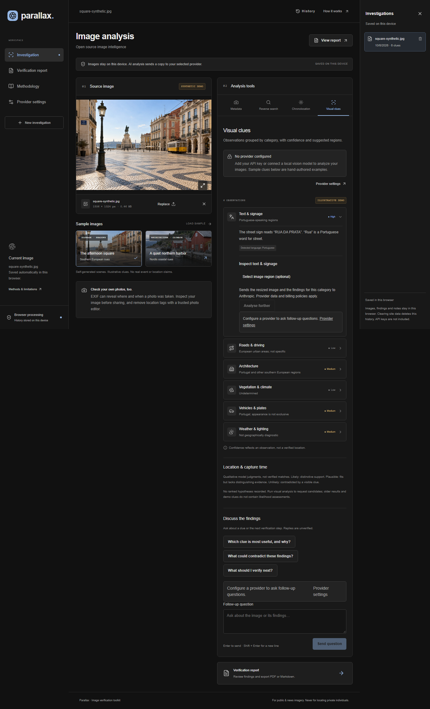

# Parallax

A browser-based workspace for verifying public and news images.

**Live:** <https://parallax.ashtonwilliamallen.com>



## Features

- EXIF/XMP metadata, GPS and a SHA-256 fingerprint, read in the browser
- Reverse image search handoffs: Google Lens, Bing, Yandex and TinEye
- Time-of-day estimates from shadow direction (SunCalc)
- AI visual clue analysis with follow-up chat, using your own Anthropic,
  OpenAI, Gemini or local (Ollama, LM Studio) model
- Verification reports as PDF or Markdown
- Local history in the browser. No signup, server image storage or analytics.

Everything except AI analysis works without a key.

## Run locally

Node.js 22+:

```sh
npm ci
npm run dev
```

Open <http://localhost:3000>. No environment variables are required.

```sh
npm run lint
npm test
npm run test:e2e   # after: npx playwright install chromium
```

## Privacy

- Images and history stay in your browser (IndexedDB).
- For AI analysis, the image is resized and its metadata stripped before it's
  sent to the provider you picked.
- Cloud keys pass through `/api/analyze` to the official provider host and are
  never logged or stored server-side.
- Local and OpenAI-compatible endpoints are called directly from the browser.

Saved settings and exported config files hold keys in plain text, so keep them
private.

## Deploying

It deploys to Vercel with the default Next.js settings. Optional environment
variables are listed in `.env.example`:

- `BASE_PATH` serves the app under a subpath.
- `DISABLE_CLOUD_AI` turns off the cloud proxy.
- The Upstash Redis variables enable distributed rate limiting.

## Limits

- Shadow analysis assumes a top-down view with known north. It doesn't correct
  perspective.
- AI findings and location or time guesses are unverified hypotheses.
- Parallax doesn't do error-level analysis, image authentication or automated
  geolocation.
- Use it on public and news imagery, not to locate private individuals.

See `/methodology` in the app for details.

MIT License. Noto Sans is under the SIL Open Font License (`public/fonts/OFL.txt`).
